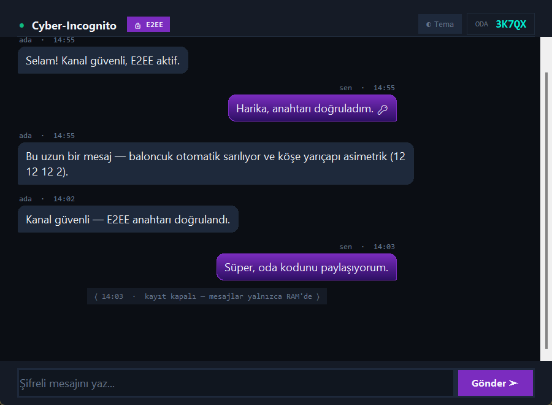

# 🔐 SecretChat

Uçtan uca şifreli (E2EE), **oda kodlu** bir masaüstü sohbet uygulaması. Modemden port açmadan,
VPN kurmadan, farklı ağlardaki kişiler 5 haneli bir kodla aynı odada buluşur.



> ## 🤖 Yapay Zeka ile Geliştirildi
> Bu proje **yapay zeka kodlama asistanları** yardımıyla geliştirilmiştir: kodun büyük bölümü
> (kripto katmanı, protokol, arayüz, testler ve bu README dahil) yapay zeka tarafından yazılmış,
> proje sahibi tarafından yönlendirilmiş ve çalıştırılarak test edilmiştir.
>
> ⚠️ **Güvenlik uyarısı:** Bu bir öğrenme/deneme projesidir. Kriptografi kütüphaneleri
> (`cryptography`, `PyNaCl`) güvenilir olsa da bu protokol **bağımsız bir güvenlik denetiminden
> geçmemiştir**. Hayati ya da yüksek hassasiyetli iletişim için Signal gibi denetlenmiş çözümleri kullanın.

---

## Ne işe yarar?

1. Biri **Oda Kur** der, ekranda `3K7QX` gibi bir kod belirir.
2. Kodu karşı tarafa başka bir kanaldan (telefon, mesaj) iletir.
3. Karşı taraf takma adını yazıp kodu girer → **Katıl**.
4. Mesajlar yalnızca iki uçta çözülebilir halde bulunur; aradaki sunucu şifreli veriden başka bir şey görmez.

## Mantığı (nasıl çalışıyor?)

### 1. Buluşma: herkese açık MQTT broker'ı posta kutusu gibi kullanılır
Uygulamanın kendi sunucusu yoktur. Herkese açık TLS'li MQTT broker'ları (`broker.emqx.io`,
`test.mosquitto.org`) üzerinde oda koduna bağlı bir *topic* açılır. Bu sayede iki tarafın da
**dışarıdan gelen bağlantıya açık port** tutmasına gerek kalmaz; ikisi de broker'a *dışarı doğru*
bağlanır (NAT/modem sorunu yaşanmaz). Bir broker çalışmazsa sıradakine otomatik geçilir.

### 2. Güven: broker'a güvenmek gerekmez
Broker yalnızca şifreli zarfları taşır. Kriptografi şöyle işler:

```
Katılan                                            Oda kurucusu (Host)
  │  HELLO: geçici X25519 pub + Ed25519 kimlik pub + nonce  │
  ├────────────────────────────────────────────────────────▶│
  │  HELLO_BACK: host pub + ortak sırla şifreli kanıt       │
  │◀────────────────────────────────────────────────────────┤
  │  HB_ACK: anahtar onayı                                  │
  ├────────────────────────────────────────────────────────▶│
  │  MEMBER_JOIN: oda anahtarı (ECIES ile sarılı)           │
  │◀────────────────────────────────────────────────────────┤
  │  DATA: AES-256-GCM ile şifreli sohbet  ◀──────────────▶│
```

| Katman | Kullanılan |
|---|---|
| Anahtar anlaşması | X25519 (ECDH) |
| Anahtar türetme | HKDF-SHA256 |
| Mesaj şifreleme | AES-256-GCM (gizlilik + bütünlük) |
| Grup anahtarı dağıtımı | ECIES (her üyeye ayrı, onun açık anahtarıyla sarılı) |
| Kimlik | Ed25519 (her oturumda yeniden üretilir) |
| Ortadaki adam kontrolü | 6 haneli **SAS kodu** — iki tarafta aynı çıkmalı |

Önemli tasarım kararı: **oda anahtarı koddan türetilmez.** Oda kodu broker'ın göreceği topic
adında geçtiği için koddan türetilen bir anahtar E2EE'yi anlamsız kılardı. Bunun yerine host,
`secrets.token_bytes(32)` ile rastgele bir anahtar üretir ve yalnızca ECIES ile üyelere dağıtır.

### 3. Savunma katmanları
- **Hız sınırlama (token bucket):** gönderim ve gelen trafik için; spam/DoS'u yavaşlatır.
- **Replay koruması:** zaman damgası penceresi (±180 sn) + görülmüş `mid`/nonce önbelleği.
- **Girdi doğrulama:** takma ad kuralları, ayrılmış adlar (`admin`, `system`…), oda kodu alfabesi
  (MQTT `+`/`#` joker karakter enjeksiyonunu önler), mesaj uzunluğu ve kontrol karakteri temizliği.
- **Sınırlı bellekler:** gelen kuyruk, görülmüş-token önbelleği ve arayüz metin tamponu üst sınırlıdır.
- **Honeypot (siber tuzak):** `vault`, `admin-secrets` gibi cazip sahte oda adları / yem oda
  kodları ve `sysadmin` gibi yem takma adlar. Bunlarla giriş deneyen oturum kara listeye alınır
  (1 saat) ve `~/Documents/SecretChat/admin-security.log` dosyasına alarm yazılır. Arayüzde ekran
  dışında gizli bir giriş alanı da vardır; otomasyon/bot formu doldurursa alarm tetiklenir.
  Reddedilme mesajı, saldırgana ipucu vermemek için sıradan bir "takma ad kullanımda" hatası gibi görünür.

### 4. Gizlilik: varsayılan olarak iz bırakmaz
Mesajlar yalnızca RAM'de tutulur ve çıkışta silinir. **"Geçmişi Kaydet"** işaretlenirse çözülmüş
metin seçtiğiniz dosyaya yazılır.

---

## Kurulum

Gereksinim: **Python 3.10+** (Tkinter ile gelir)

```bash
git clone https://github.com/Talatberke/Schat.git
cd Schat
python -m venv .venv
# Windows: .venv\Scripts\activate
source .venv/bin/activate
pip install -r requirements.txt
python main.py
```

### Tek dosya (.exe) derleme
```bash
build_exe.bat                                  # Windows → dist\SecretChat.exe
chmod +x build_exe.sh && ./build_exe.sh        # Linux/macOS → dist/SecretChat
```

## Testler

```bash
python -m pytest tests -q              # hepsi (ağ testleri dahil)
SKIP_NET=1 python -m pytest tests -q   # yalnızca çevrimdışı testler
```
Arayüz testleri Tkinter gerektirir.

## Proje yapısı

```
main.py                    # giriş noktası
secretchat/
  config.py                # sabitler: broker, kod uzunluğu, limitler, honeypot ayarları
  crypto.py                # X25519, HKDF, AES-GCM, ECIES, Ed25519, SAS
  messages.py              # protokol zarfları + doğrulama/temizleme
  signaling.py             # TLS'li MQTT kanalı, broker yedekleme
  room.py                  # Host/Client mantığı, el sıkışma, grup anahtarı dağıtımı
  security.py              # token bucket hız sınırlayıcı
  honeypot.py              # tuzak odalar, kara liste, alarm günlüğü
  storage.py               # RAM modu / isteğe bağlı dosya kaydı
  stun.py, p2p.py          # STUN + UDP delik açma (deneysel, henüz ana yol değil)
  theme.py, components.py  # "Cyber-Incognito" teması (bkz. THEME.md)
  ui.py                    # Tkinter arayüzü
tests/                     # birim + entegrasyon testleri
tools/                     # hata ayıklama / ekran görüntüsü araçları
docs/                      # ekran görüntüleri
```

## Bilinen sınırlar (dürüst liste)

- **Oda kodu tek giriş sırrıdır.** 5 haneli kod kısa ve broker topic'inde görünür; kodu bilen
  katılmayı deneyebilir. Hassas odalarda **SAS kodunu mutlaka karşılaştırın**.
- **Meta veri görünür:** broker mesajı okuyamaz ama zamanlamayı, boyutu ve topic'i görür.
  Daha fazla gizlilik için kendi broker'ınızı kurup `config.py` → `DEFAULT_BROKER` değerini değiştirin.
- **Anahtar rotasyonu yok:** geçici anahtarlar oturum bitince silinir ama Double Ratchet gibi
  mesaj-bazlı ileri gizlilik yoktur. X25519 kuantum-sonrası dayanıklı değildir.
- **Honeypot sınırı:** broker istemci IP'sini göstermediğinden kara liste IP'ye değil oturum
  kimliğine dayanır; saldırgan yeni kimlikle tekrar deneyebilir.
- **P2P katmanı** (STUN/UDP) temel olarak mevcuttur; şu an trafik TLS'li broker üzerinden akar.
- Herkese açık broker'lar kesinti yapabilir veya hız sınırı uygulayabilir.

## Lisans

Henüz bir lisans seçilmedi. Paylaşmak istiyorsanız `LICENSE` dosyası ekleyin (ör. MIT).
